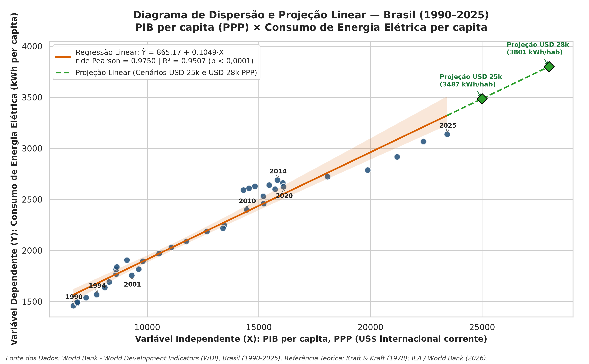
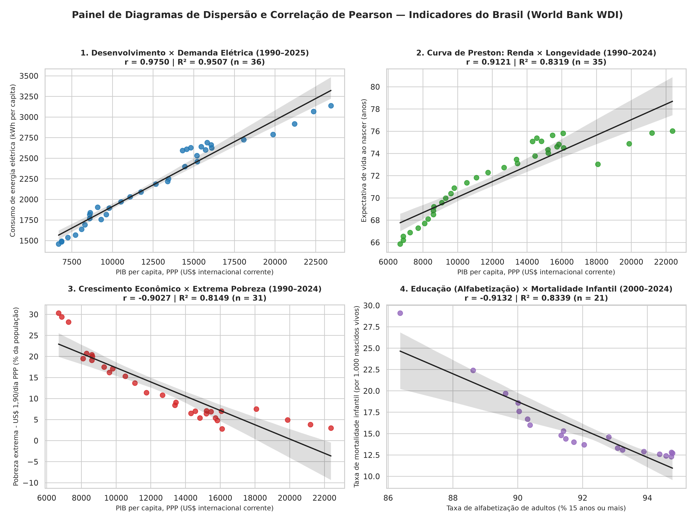
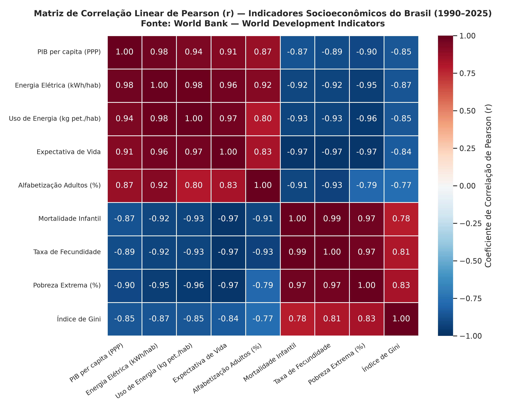

# Análise de Correlação Linear de Pearson e Projeção de Dados — Brasil (1990–2025)

**Autores:** **Thiago Allan** e **Everson Diogo**

Estudo de **Estatística Aplicada** sobre o tratamento de séries históricas oficiais do **Banco Mundial (*World Development Indicators — WDI*)**, cálculo algébrico e computacional do **Coeficiente de Correlação Linear de Pearson ($r$)**, testes de hipóteses ($t$ de Student e valor-$p$), diagramas de dispersão e projeções por regressão linear simples ($\hat{Y} = b_0 + b_1 X$).

---

## 📊 Visualização Rápida do Estudo

* 📓 **Notebook Completo (Python / Jupyter):** [`analise_correlacao_pearson_brasil.ipynb`](./analise_correlacao_pearson_brasil.ipynb)
* 📗 **Planilha Excel com Fórmulas Nativas (`=CORREL`, `=PEARSON`, `=RQUAD`) e Gráficos:** [`output/Analise_Correlacao_Pearson_Brasil_WorldBank.xlsx`](./output/Analise_Correlacao_Pearson_Brasil_WorldBank.xlsx)
* 🌐 **Relatório em HTML:** [`output/analise_correlacao_pearson_brasil.html`](./output/analise_correlacao_pearson_brasil.html)

---

## 📈 Principais Resultados Obtidos

| Estudo / Par de Variáveis ($X \times Y$) | Período ($n$) | $r$ de Pearson | Determinação ($R^2$) | Estatística $t$ (Valor-$p$) | Equação de Regressão Linear ($\hat{Y}$) | Classificação da Correlação |
| :--- | :---: | :---: | :---: | :---: | :---: | :--- |
| **1. PIB per capita PPP $\times$ Consumo de Energia Elétrica** | 1990–2025 ($n=36$) | **$0,9750$** | $95,07\%$ | $t = 25,60$ ($p = 8,38 \times 10^{-24}$) | $\hat{Y} = 865,17 + 0,1049X$ | Positiva **Muito Forte** |
| **2. PIB per capita PPP $\times$ Expectativa de Vida (Curva de Preston)** | 1990–2024 ($n=35$) | **$0,9121$** | $83,19\%$ | $t = 12,78$ ($p = 2,49 \times 10^{-14}$) | $\hat{Y} = 63,11 + 0,000697X$ | Positiva **Muito Forte** |
| **3. PIB per capita PPP $\times$ Extrema Pobreza (% pop.)** | 1990–2024 ($n=31$) | **$-0,9027$** | $81,49\%$ | $t = -11,30$ ($p = 3,84 \times 10^{-12}$) | $\hat{Y} = 34,27 - 0,001694X$ | Negativa **Muito Forte** |

---

## 🖼️ Diagramas de Dispersão e Matriz de Correlação

### 1. Diagrama Principal e Projeção Linear (PIB per capita PPP $\times$ Consumo Elétrico)

### 2. Painel de Dispersão 2×2 — Realidade Socioeconômica Brasileira

### 3. Matriz de Correlação Linear de Pearson ($r$)

---

## 📁 Estrutura de Arquivos do Repositório

* [`analise_correlacao_pearson_brasil.ipynb`](./analise_correlacao_pearson_brasil.ipynb) — Notebook Jupyter com toda a fundamentação matemática, cálculos passo a passo, gráficos e conclusões.
* [`gerar_analise_e_excel.py`](./gerar_analise_e_excel.py) — Script Python que automatiza a limpeza dos dados, geração dos gráficos de alta resolução, exportação dos CSVs e construção da planilha `.xlsx`.
* [`output/`](./output/) — Resultados exportados:
  * [`Analise_Correlacao_Pearson_Brasil_WorldBank.xlsx`](./output/Analise_Correlacao_Pearson_Brasil_WorldBank.xlsx) — Planilha Excel com 4 abas e cálculos ativos.
  * [`base_brasil_tratada_1990_2025.csv`](./output/base_brasil_tratada_1990_2025.csv) — Série histórica tratada (1990–2025).
  * [`1_analise_pib_vs_energia_pearson.csv`](./output/1_analise_pib_vs_energia_pearson.csv) — Tabela algébrica passo a passo ($x_i-\bar{x}$, $y_i-\bar{y}$, produtos, quadrados e projeção $\hat{Y}$).
  * [`2_analise_pib_vs_expectativa_vida_pearson.csv`](./output/2_analise_pib_vs_expectativa_vida_pearson.csv) — Tabela algébrica passo a passo da Curva de Preston.
  * [`3_analise_pib_vs_pobreza_extrema_pearson.csv`](./output/3_analise_pib_vs_pobreza_extrema_pearson.csv) — Tabela algébrica passo a passo de PIB $\times$ Pobreza Extrema.
  * [`4_resumo_estatistico_e_projecoes_pearson.csv`](./output/4_resumo_estatistico_e_projecoes_pearson.csv) — Quadro resumo das métricas e projeções.
  * [`5_matriz_correlacao_pearson_brasil.csv`](./output/5_matriz_correlacao_pearson_brasil.csv) — Matriz de correlação de Pearson completa.
* [`data/`](./data/) — Base de dados oficial do Banco Mundial (*World Development Indicators* — Brasil).

---

## 📚 Referências Bibliográficas e Fonte dos Dados

1. **WORLD BANK.** *World Development Indicators (WDI) — Brazil (BRA)*. Washington, DC: The World Bank Group, 2026. Disponível em: <https://data.worldbank.org/country/brazil>.
2. **KRAFT, J.; KRAFT, A.** On the relationship between energy and GNP. *The Journal of Energy and Development*, v. 3, n. 2, p. 401–403, 1978.
3. **PRESTON, S. H.** The Changing Relation between Mortality and Level of Economic Development. *Population Studies*, v. 29, n. 2, p. 231–248, 1975.
4. **RAVALLION, M.; CHEN, S.** Measuring Pro-Poor Growth. *Economics Letters*, v. 78, n. 1, p. 93–99, 2003.
